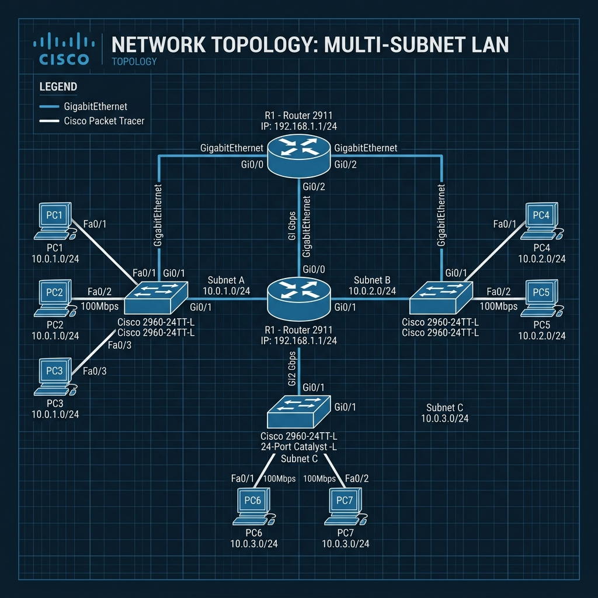

# TELNET vs SSH Configuration — Cisco Packet Tracer Project


A professional Cisco Packet Tracer demonstration comparing legacy **Telnet (cleartext remote management)** against secure **SSH v2 (Encrypted Secure Shell)** across a multi-subnet enterprise network topology.

---

## 📋 Table of Contents

- [Project Objective](#-project-objective)
- [Network Topology](#-network-topology)
- [Hardware & Device Specifications](#-hardware--device-specifications)
- [Router IP Addressing Scheme](#-router-ip-addressing-scheme)
- [Cisco IOS SSH Configuration](#-cisco-ios-ssh-configuration)
- [Telnet vs SSH Comparison](#-telnet-vs-ssh-comparison)
- [Testing & Verification Performed](#-testing--verification-performed)
- [Tools Used](#-tools-used)
- [Repository Structure](#-repository-structure)
- [Documentation & Resources](#-documentation--resources)

---

## 🎯 Project Objective

The main objectives of this Cisco Packet Tracer project are:
1. Design and deploy a multi-subnet enterprise local area network (LAN) routed by a central **Cisco 2911 Router**.
2. Interconnect three subnets using three **Cisco Catalyst 2960-24TT Switches** servicing a total of **7 end-user PCs**.
3. Configure inter-subnet IP routing and assign standard gateway addressing across router interfaces.
4. Implement local user authentication (`username`/`secret`), host domain configuration, and 2048-bit RSA key pairs to enable **Secure Shell Version 2 (SSH v2)**.
5. Perform side-by-side protocol comparison testing between **Telnet (Port 23)** and **SSH (Port 22)** to demonstrate the critical security risks of cleartext administrative management vs ciphertext encryption.

---

## 🌐 Network Topology

The network uses a multi-LAN star topology where three access switches (`SW-LAN1`, `SW-LAN2`, `SW-LAN3`) aggregate endpoint PCs and connect directly to individual GigabitEthernet interfaces on the central core router (`R1-Core`).



```
                                +----------------------------+
                                |       Cisco 2911           |
                                |      R1-Core Router        |
                                +--------------+-------------+
                                               |
           +-----------------------------------+-----------------------------------+
           | Gi0/0                             | Gi0/1                             | Gi0/2
           v                                   v                                   v
+----------------------+            +----------------------+            +----------------------+
|   SW-LAN1 (2960)     |            |   SW-LAN2 (2960)     |            |   SW-LAN3 (2960)     |
|   192.168.10.0/24    |            |   192.168.20.0/24    |            |   192.168.30.0/24    |
+---+------+------+----+            +---+------+-----------+            +---+------+-----------+
    |      |      |                     |      |                            |      |
    v      v      v                     v      v                            v      v
  PC-1   PC-2   PC-3                  PC-4   PC-5                         PC-6   PC-7
```

---

## 🛠️ Hardware & Device Specifications

The repository includes the `.pkt` file pre-configured with the following hardware specs:

| Device Type | Count | Model / Hardware Series | Role in Topology |
| :--- | :---: | :--- | :--- |
| **Central Router** | **1** | **Cisco 2911** Integrated Services Router | Inter-subnet routing, Default Gateway, SSH/Telnet server |
| **Access Switches** | **3** | **Cisco Catalyst 2960-24TT** (24 FE + 2 GE) | Layer-2 aggregation switches for LAN 1, LAN 2, and LAN 3 |
| **End Stations** | **7** | **Generic Desktop PCs** (`PC-1` to `PC-7`) | Workstations used to run ping tests and remote CLI access |

---

## 🔢 Router IP Addressing Scheme

The Cisco 2911 router provides default gateway services across three IPv4 `/24` subnets:

| Device | Interface | IP Address | Subnet Mask | Default Gateway | Subnet / Department |
| :--- | :--- | :--- | :--- | :--- | :--- |
| **R1-Core** | `GigabitEthernet0/0` | `192.168.10.1` | `255.255.255.0` | N/A | LAN 1 Gateway (Finance) |
| **R1-Core** | `GigabitEthernet0/1` | `192.168.20.1` | `255.255.255.0` | N/A | LAN 2 Gateway (Engineering) |
| **R1-Core** | `GigabitEthernet0/2` | `192.168.30.1` | `255.255.255.0` | N/A | LAN 3 Gateway (Management) |
| **SW-LAN1** | `VLAN 1` | `192.168.10.2` | `255.255.255.0` | `192.168.10.1` | LAN 1 Switch Mgmt |
| **SW-LAN2** | `VLAN 1` | `192.168.20.2` | `255.255.255.0` | `192.168.20.1` | LAN 2 Switch Mgmt |
| **SW-LAN3** | `VLAN 1` | `192.168.30.2` | `255.255.255.0` | `192.168.30.1` | LAN 3 Switch Mgmt |
| **PC-1** | `FastEthernet0` | `192.168.10.10` | `255.255.255.0` | `192.168.10.1` | LAN 1 Workstation |
| **PC-2** | `FastEthernet0` | `192.168.10.11` | `255.255.255.0` | `192.168.10.1` | LAN 1 Workstation |
| **PC-3** | `FastEthernet0` | `192.168.10.12` | `255.255.255.0` | `192.168.10.1` | LAN 1 Workstation |
| **PC-4** | `FastEthernet0` | `192.168.20.10` | `255.255.255.0` | `192.168.20.1` | LAN 2 Workstation |
| **PC-5** | `FastEthernet0` | `192.168.20.11` | `255.255.255.0` | `192.168.20.1` | LAN 2 Workstation |
| **PC-6** | `FastEthernet0` | `192.168.30.10` | `255.255.255.0` | `192.168.30.1` | LAN 3 Workstation |
| **PC-7** | `FastEthernet0` | `192.168.30.11` | `255.255.255.0` | `192.168.30.1` | LAN 3 Workstation |

*For complete addressing details, see [IP Addressing Table Document](documentation/ip_addressing_table.md).*

---

## 🔒 Cisco IOS SSH Configuration

The Cisco 2911 router is configured with SSH version 2 using local database authentication and a 2048-bit RSA key pair:

```ios
! 1. Set System Hostname and IP Domain Name
hostname R1-Core
ip domain-name enterprise.local

! 2. Configure Local User Credentials with Privileged Access
username admin privilege 15 secret AdminSSH2026!

! 3. Generate RSA Key Pair (2048-bit modulus)
crypto key generate rsa modulus 2048

! 4. Force SSH Version 2 and Set Timeouts
ip ssh version 2
ip ssh timeout 60
ip ssh authentication-retries 3

! 5. Configure Virtual Terminal Lines (VTY)
line vty 0 4
 login local
 transport input ssh telnet
exit

line vty 5 15
 login local
 transport input ssh
exit
```

---

## ⚖️ Telnet vs SSH Comparison

| Feature / Metric | Telnet Protocol | Secure Shell (SSH v2) |
| :--- | :--- | :--- |
| **Protocol Standard** | RFC 854 | RFC 4253 |
| **Port Number** | TCP Port 23 | TCP Port 22 |
| **Data Confidentiality** | ❌ None (Plaintext ASCII) | ✅ Strong Cipher Encryption (AES-256) |
| **Authentication Security** | ❌ Cleartext User/Pass | ✅ RSA Public Key / Encrypted Password |
| **Data Integrity** | ❌ Vulnerable to Packet Injections | ✅ HMAC SHA-2 Hash Verification |
| **Packet Capture Risk** | ❌ Full Password & Command Exposure | ✅ Completely Ciphertext-Protected |
| **Recommended Environment** | Deprecated / Disallowed in Production | Required Enterprise Standard |

---

## 🧪 Testing Performed

### 1. Inter-Subnet Connectivity Verification
Full ICMP connectivity was verified across all subnets:
- Executed `ping 192.168.20.10` (PC-1 to PC-4): `100% success`
- Executed `ping 192.168.30.11` (PC-1 to PC-7): `100% success`
- Executed `ping 192.168.10.1` (Gateway ping): `100% success`

### 2. Telnet Connection & Packet Capture Test
- Executed `telnet 192.168.10.1` from PC Command Prompt.
- Authenticated with username `admin` and password `TelnetPass123!`.
- Captured PDUs in Cisco Packet Tracer **Simulation Mode**.
- **Result**: Inspection of TCP Telnet PDUs revealed unencrypted plaintext characters for credentials and CLI inputs.

### 3. SSH Version 2 Connection Test
- Executed `ssh -l admin 192.168.10.1` from PC Command Prompt.
- Successfully entered password `AdminSSH2026!` and accessed Cisco IOS EXEC mode (`R1-Core#`).
- Captured PDUs in Cisco Packet Tracer **Simulation Mode**.
- **Result**: Inspection of TCP Port 22 SSH PDUs showed fully encrypted ciphertext blocks.

---

## 🧰 Tools Used

- **Cisco Packet Tracer (v8.x)** — Network simulation, topology layout, IOS CLI configuration, and Simulation Mode packet capture.
- **Cisco IOS (C2911-UNIVERSALK9-M)** — Router Operating System.
- **Cisco Catalyst 2960 IOS** — Access Switch Operating System.
- **Git & GitHub** — Version control and repository hosting.

---

## 📁 Repository Structure

```
TELNET-vs-SSH-Configuration/
├── TELNET-vs-SSH-Configuration.pkt   # Cisco Packet Tracer Project File (Unmodified)
├── README.md                          # Main Repository Readme
├── .gitignore                         # Git Ignore configuration
├── screenshots/
│   └── topology_diagram.png           # Network Topology Diagram
└── documentation/
    ├── network_topology.md            # Hardware & Interface Specifications
    ├── ip_addressing_table.md         # Full IP Addressing Scheme Matrix
    ├── cisco_ios_configuration.md     # Step-by-step Cisco IOS CLI Configurations
    └── telnet_vs_ssh_security_analysis.md # Detailed Security & Packet Capture Analysis
```

---

## 📚 Documentation & Resources

- [Network Topology Specifications](documentation/network_topology.md)
- [Complete IP Addressing Matrix](documentation/ip_addressing_table.md)
- [Cisco IOS CLI Configuration Guide](documentation/cisco_ios_configuration.md)
- [Telnet vs SSH Security Analysis](documentation/telnet_vs_ssh_security_analysis.md)

---

## 📄 License

This repository is open-sourced under the [MIT License](LICENSE).
